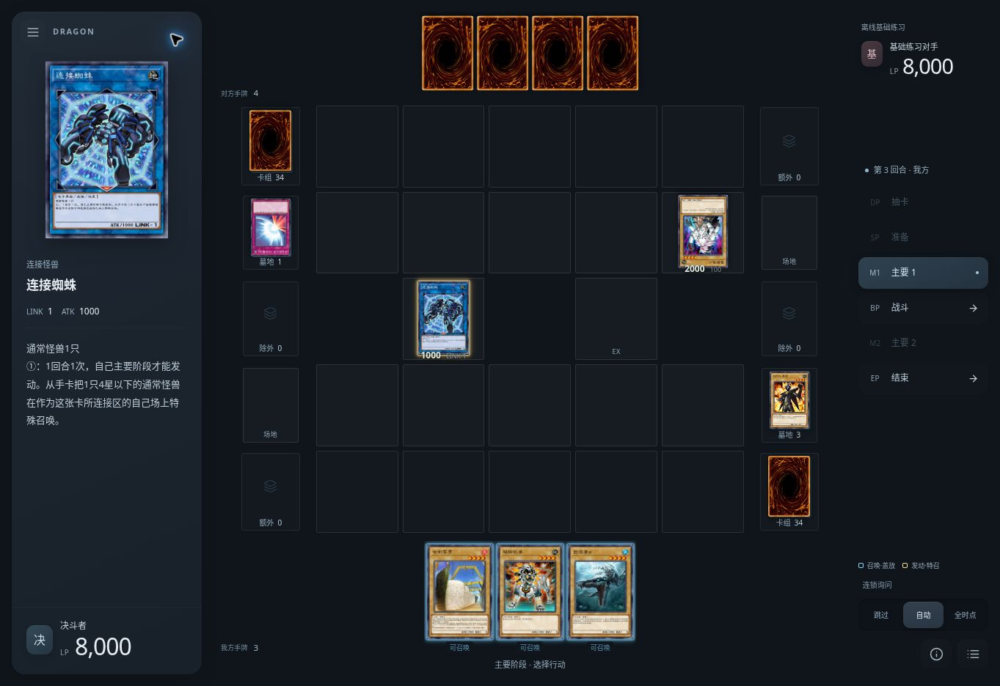
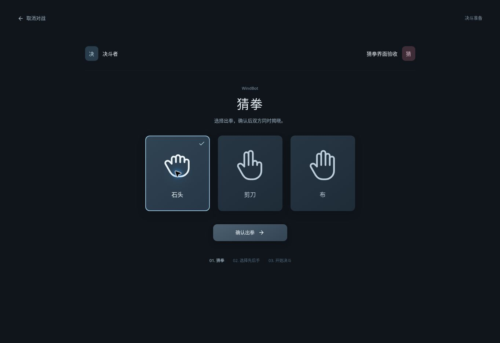

# YGO Dragon

从头编写的游戏王网页对战平台。采用深色、有层次的表面和柔和按钮材质，无装饰性背景图片；卡图、卡库和规则脚本独立保存到本地。参考 neos-ts 的场地比例、区域关系与操作流程，重新实现前端和适配层。





[先后手选择](docs/turn-order.png) · [素材最终确认](docs/material-confirm.png) · [动画实录](docs/animation.mp4)

[查看大厅](docs/preview.png) · [单人对手选择](docs/opponents.png)

[查看卡组编辑器](docs/editor.png) · [查看卡片旁行动菜单](docs/actions.png)

## 已实现

- 大厅、卡组管理、三分区编辑器，卡名/效果/密码检索，类型筛选，拖放、双击添加、右键移除，YDK 导入导出。
- 独立猜拳与先后手准备页：手势选择、确认出拳、双方揭晓、平局重猜和服务器决定的选择权。
- WindBot 单人对战：可搜索、收藏和筛选 44 项 MDPro3 对手配置，包括「我太帅了」；支持指定 Deck 调用、猜拳与先后手。离线基础练习为独立可选入口。
- 真正的 `ocgcore-wasm` / EDOPro 规则核心用于本地练习及同一服务器中的双人房间，支持准备、重连、认输。
- 按 neos-ts 的区域关系重排七列五行平面场地：正常卡牌比例的对方手牌、平铺我方手牌、左右镜像的卡组/额外/墓地/除外；左侧卡片详情，右侧阶段快捷切换和连锁控制，行动菜单贴近卡片。
- 蓝色边框提示普通召唤、盖放等普通行动，金色边框提示发动与特殊召唤；根据当前合法提示即时更新，覆盖手牌、场上、卡堆与浏览列表。
- 素材先在界面暂存，最后统一确认再提交；即使固定素材脚本会自动继续，也保留最终确认。支持再次点击、右键撤销、全部取消与 Enter 确认。
- 墓地、除外、额外卡组直接列表查看；连锁询问、阶段切换、战斗、生命值与决斗记录。
- 不向对手发送手牌、盖卡、里侧额外/除外卡和卡组顺序。本地规则对局在独立 Worker 中运行；WindBot 上游连接由房间持有，浏览器短暂重连不会另开一局。
- 本地资源按需下载、受控并发、多来源回退、断点恢复、内容校验、条件更新和失败重试。
- 深色分层表面、柔和高光与阴影、下压反馈、三种低饱和强调色；按钮、输入框、卡组与对手选择统一材质。按位置插值的移动动画、顺序事件播放、独立旋转与 LP 过渡，支持快速/关闭及系统减少动态效果。结束回合与认输防误触。

## 运行

需要 Node.js **24 或更新版本**，或使用 Docker。卡库与图片需要在第一次使用时从配置的来源下载。

```bash
git clone https://github.com/ant3190/ygo-dragon.git
cd ygo-dragon
cp .env.example .env
```

编辑 `.env`，将 `YGO_DATA_DIR` 设置为项目外的绝对路径，例如 `/mnt/data/ygo-dragon`。路径通过 `.env` 统一配置。

### Docker

```bash
docker compose up -d --build
```

打开 `http://localhost:18081`。联机时双方访问同一个服务地址，创建房间并分享房间码。更新程序：

```bash
git pull
docker compose up -d --build
```

数据库、卡图和卡组档案位于挂载的数据目录，重建容器不会删除它们。可选的 `YGO_LEGACY_DATA_DIR` 可设置为原 neos 数据目录，只读复用它的卡图。

### 直接运行

```bash
npm ci
npm run build
npm start
```

开发：`npm run dev`，同时启动 Vite 和本地服务。未设置 `YGO_DATA_DIR` 时，开发模式使用项目同级的 `ygo-dragon-data` 文件夹。生产模式必须显式设置目录。

### 本地资源

第一次启动先准备卡库、字符串、禁限表和规则脚本；完成后可开始对战。卡图按使用需要下载。设置页可提前下载全部已保存卡组的卡图，也可后台补全全卡库。

- 卡库默认来源：`cdncf.moecube.com`，失败后回退到 `cdn02.moecube.com:444`。可通过 `YGO_DATABASE_URLS` 和 `YGO_IMAGE_BASES` 配置自己的镜像，逗号分隔。
- 更新检查默认间隔 6 小时，间隔内复用检查记录。远端支持时使用 ETag / Last-Modified；不支持条件请求时下载后按 SHA-256 判断内容是否变化。
- 断点仅用于同一 URL、同一强 ETag 或 Last-Modified 的文件；镜像变化、Range 被忽略或版本变化时重新开始，避免拼接不同版本。
- SQLite 做完整性与表结构检查；图片做完整解码；脚本 ZIP 检查结构和路径。通过验证后才原子替换，失败保留旧文件。
- 脚本用 Git 提交哈希标识版本，按版本目录保存；手动修复也安装新目录，进行中的对局继续使用原来的脚本快照。
- `404` 只有在所有源都明确返回 `404` 时才记录为暂缺；网络/5xx 仍算可重试失败。暂缺 1 小时后重试，普通失败 1 分钟后重试，设置页可立即重试。
- 资源目录中的 `resources.sqlite` 保存版本/摘要，`cards.cdb` 保存卡库，`images/` 保存图片，`scripts/` 保存脚本，`players.sqlite` 保存卡组档案。
- 镜像应提供相同格式的 SQLite / JPEG 文件及正确的 HTTP 响应；不要填需要网页登录的分享链接。脚本版本与归档源也可在 `.env` 配置。

停止服务后可用 CLI 单独准备资源：

```bash
npm run resources:sync
# 完整校验并修复
npm run resources:sync -- --force
```

设置中的「检查更新」会立即发送条件请求核对远端版本，未变化的内容不重复下载；「校验与重试」还会检查已安装内容并重建脚本版本目录。卡库没有官方逐文件清单，因此不能只凭文件大小判断新旧，也不声称存在上游未提供的增量补丁。

### 单人对战服务器

默认使用 `wss://koishi.momobako.com:7211` 的 YGOPro / WindBot 兼容服务。`.env` 可设置 `YGO_AI_SERVER` 和 `YGO_AI_VERSION`，默认版本为 `4962`。服务必须支持 `/ai` 命令；「我太帅了-真红眼龙骑士」按 `/ai Dragun` 调用，服务器昵称可能不同。对手搜索、收藏和难度分类使用 MDPro3 对手配置，实际可用的 Deck 由服务器决定，不可用时会明确报错。

MDPro3 原生单人模式启动的是本地 YGO 服务和 WindBot；它的 MyCard 登录端点不等于匿名网页单人服务。本项目接入兼容 WindBot 服务，不声称复用 MyCard 账号登录。来源、协议与操作细节见 [docs/interaction.md](docs/interaction.md)。

## 验证

```bash
npm run check
# 需要先完成本地资源准备，进行四场真实核心自动对局
npm run test:duel
# 双人房间、权限隔离、断线重连与认输的集成检查
npm run test:room
# 查看公网测试的数据范围；不发起网络连接
npm run test:ai
# 使用脚本内固定公开卡号进行一场 WindBot 公网对局
npm run test:ai -- --connect
```

29 项单元和本地协议检查覆盖下载恢复、备用源、旧文件保留、多选确认/取消、区域掩码、双重解放、素材求和、固定素材草稿、条件变化、隐藏信息，以及 WindBot 分包/粘包、指定 AI、先后手坐标转换和连续撤销。真实核心测试使用随机洗牌并验证每次合法响应，不使用模拟规则替代。房间检查还覆盖卡组保存、持久化、跨站请求拒绝、席位隔离、断线重连和认输。

浏览器已走通普通召唤、盖卡、右键撤回、多选弃牌、链接素材最终确认、额外卡组入口、链接后的特殊召唤及守备方向。公开固定测试卡组本轮对 `/ai Dragun` 完成一场公网对局（4 回合、12 次合法响应，正常结算）；该脚本不读取已保存卡组或玩家档案。

0.4 界面在 1363×936 桌面视口完成真实规则对局验收：普通召唤、盖卡、链接素材最终确认、链接后的发动与特殊召唤、守备方向、对手回合的连锁发动、破坏、送墓、抽卡、蓝/金可操作边框及动画结束后的清理。浏览器缩放至 909×624 CSS 视口时，场地没有横向溢出，紧凑菜单可正常打开与关闭。四场随机真实核心对局和双人房间检查通过。猜拳浏览器验收使用仅回环网络的真实协议适配器测试端点，覆盖平局重试、获胜、先后手和取消；不以该测试端点模拟规则对局。文档图片与动画均捕捉自实际运行界面。

## 当前边界

这是独立可运行的 0.4 版。单人对战依赖配置的外部 WindBot 服务及其 Deck 支持；44 项对手配置并不代表每个公开服务器都安装了全部对手。离线基础练习使用简单策略，适合熟悉基础操作。双人房间为本项目服务内房间；不包含 MyCard 账号登录、匹配排位、录像回放、观战、完整音效库或 Master Duel 的演出素材。

默认练习房使用**无禁限表**规则，仍校验主/额外/副卡组容量与同名卡数量。禁限文件已保留在本地供后续规则扩展，不会假称当前已强制执行 OCG 最新禁限表。编辑器可保存不完整草稿，对战前会重新校验卡组。

卡组档案由当前浏览器的长期 Cookie 识别，设置保存在浏览器中；清理 Cookie 会失去对原档案的访问入口。重要卡组请导出 YDK，备份数据目录时包含 `players.sqlite`。

## 设计与授权

视觉规范与设计参考见 [docs/design.md](docs/design.md)。前端采用 React / TypeScript / Vite，线性图标来自 Lucide。

本项目不附带卡面原图、卡库或卡片脚本；它们由用户配置的来源下载并仅缓存在本地。文档包含界面实机截图。游戏王名称与卡片相关内容属于各自权利人，非官方项目。

- `ocgcore-wasm`：MIT 包装层；其包含的 EDOPro 核心受 AGPL-3.0 约束，来源与许可证见 [THIRD_PARTY.md](THIRD_PARTY.md)。
- Project Ignis CardScripts：AGPL-3.0，下载版本保留上游 `COPYING`，源版本以本地 `scripts-current.json` 的 SHA 标识。
- 本仓库原创代码使用 AGPL-3.0-or-later。
